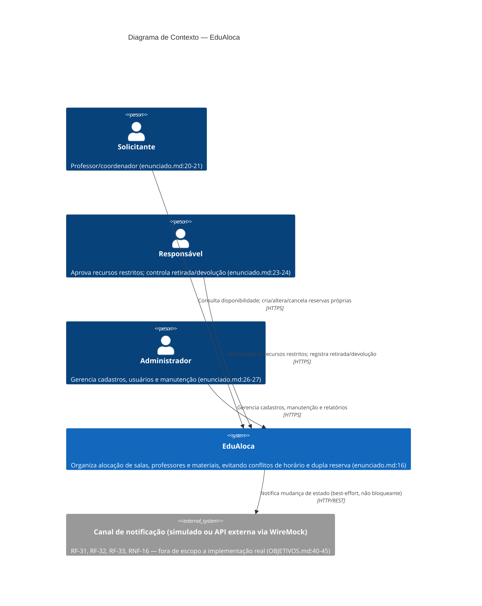
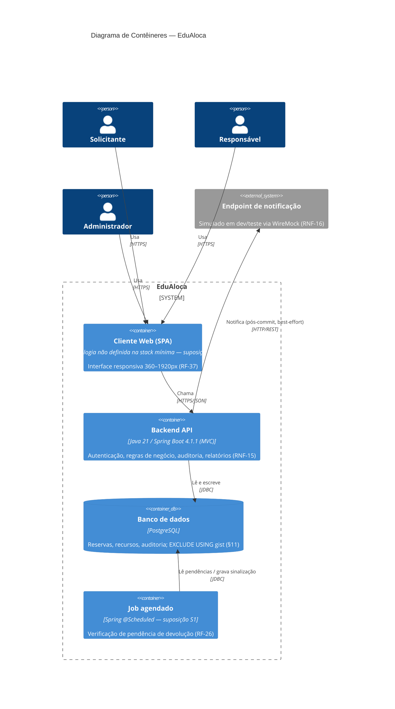
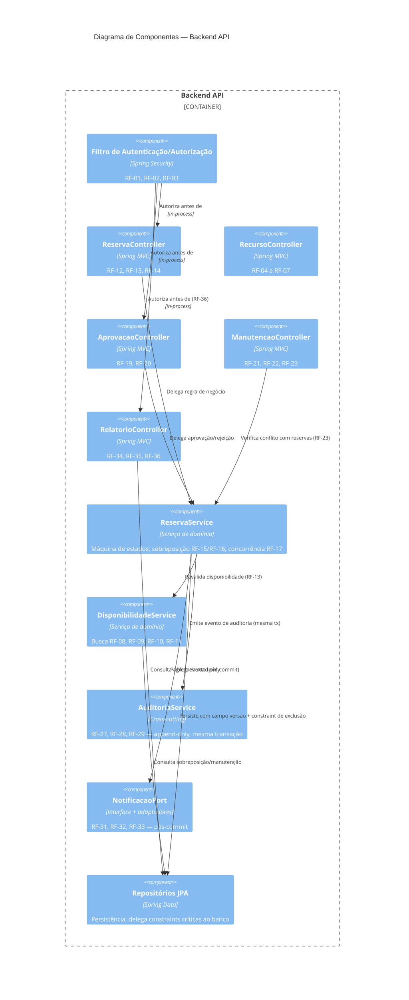
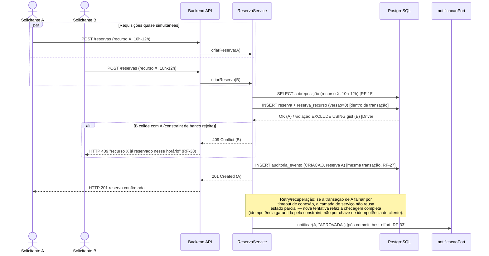
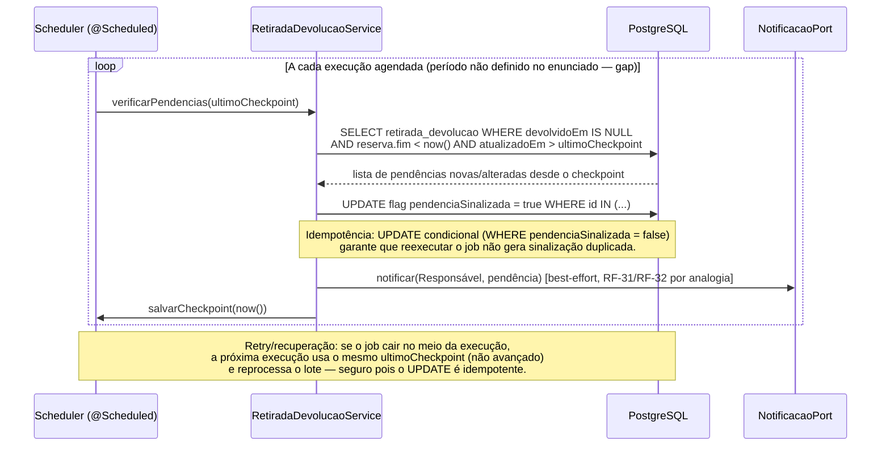
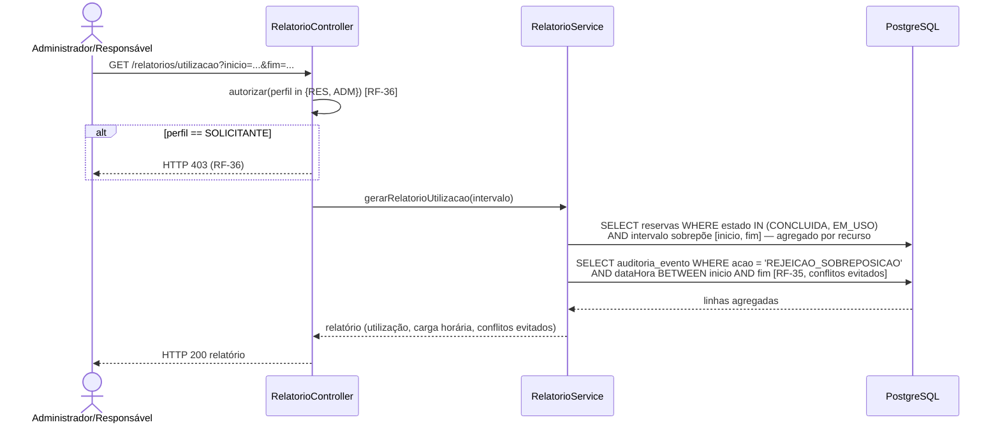

  # Arquitetura — EduAloca

> **Fonte de verdade:** [DOCS/enunciado.md](enunciado.md) (documento imutável). Em caso de
> conflito entre este documento e o enunciado, o enunciado prevalece. Os demais artefatos
> consultados são [DOCS/PERSONAS/](PERSONAS/), [DOCS/REQUISITOS/REQUISITOS.md](REQUISITOS/REQUISITOS.md),
> [DOCS/REQUISITOS/OBJETIVOS.md](REQUISITOS/OBJETIVOS.md), [DOCS/REQUISITOS/JORNADAS.md](REQUISITOS/JORNADAS.md)
> e [DOCS/REQUISITOS/MODELAGEM_DADOS.md](REQUISITOS/MODELAGEM_DADOS.md) /
> [MODELAGEM_DADOS.dbml](REQUISITOS/MODELAGEM_DADOS.dbml).
>
> Este documento **não altera** requisitos nem introduz tecnologia, usuário, volume ou SLA
> não citado nos artefatos acima. Nenhum código foi implementado nesta etapa.

---

## 1. Contexto e objetivo

O EduAloca é uma aplicação que organiza a alocação de salas, professores e materiais de uma
instituição de ensino, eliminando conflitos de horário e dupla reserva de recursos
(enunciado.md:16, OBJETIVOS.md:8-10). O objetivo da avaliação não é apenas o funcionamento
do sistema, mas a apresentação de evidências objetivas de qualidade, segurança,
rastreabilidade e desempenho (enunciado.md:16).

Entidade de domínio central: a **Reserva**, que liga um solicitante a um ou mais recursos
(sala, professor e/ou material) por um intervalo de tempo, percorrendo uma máquina de
estados auditada (`SOLICITADA → APROVADA → EM_USO → CONCLUÍDA`, com desvios `REJEITADA`,
`CANCELADA`, `NAO_COMPARECEU` — enunciado.md:56-58; JORNADAS.md:149-155;
MODELAGEM_DADOS.md:80-97).

Fora de escopo nesta fase (OBJETIVOS.md:40-45): integração real com sistemas acadêmicos
externos (SIGAA, Moodle — notificação externa pode ser simulada ou via WireMock),
cobrança/financeiro, aplicativo mobile nativo.

## 2. Stakeholders / Personas

Três perfis de acesso, definidos no enunciado (enunciado.md:18-27) e detalhados em
[DOCS/PERSONAS/](PERSONAS/):

| Persona | Papel | Documento | RFs principais relacionados |
|---|---|---|---|
| **Solicitante** | Professor/coordenador; consulta disponibilidade e cria, altera ou cancela **suas próprias** reservas. | [PERSONAS/solicitante.md](PERSONAS/solicitante.md) | RF-02, RF-03, RF-04 a RF-14, RF-31, RF-37, RF-38 (REQUISITOS.md; solicitante.md:58-62) |
| **Responsável** | Aprova solicitações de recursos restritos, valida alocação de docentes, acompanha retirada/devolução de material. Não gerencia cadastros. | [PERSONAS/responsavel.md](PERSONAS/responsavel.md) | RF-18 a RF-20, RF-24 a RF-26, RF-32, RF-34, RF-36 (responsavel.md:61-66) |
| **Administrador** | Gerencia salas, professores, materiais, usuários, bloqueios e períodos de manutenção. Perfil de acesso mais amplo. | [PERSONAS/administrador.md](PERSONAS/administrador.md) | RF-01, RF-02, RF-04 a RF-06, RF-21 a RF-23, RF-27 a RF-30, RF-34, RF-39 (administrador.md:65-70) |

Não há, nos artefatos lidos, definição de volumetria de usuários (número de solicitantes,
responsáveis ou administradores esperados) — ver [§7 Lacunas](#7-lacunas-e-perguntas-em-aberto).

## 3. Requisitos arquiteturalmente significativos (RAS)

Requisitos de [REQUISITOS.md](REQUISITOS/REQUISITOS.md) com maior impacto estrutural —
todos classificados como **Crítico** na origem:

| RF | Descrição resumida | Por que é arquiteturalmente significativo |
|---|---|---|
| RF-15, RF-16 | Detecção de sobreposição de horário por recurso, inclusive na agenda do professor quando acessório de outra reserva. | Exige modelo de dados que associe reserva a múltiplos recursos de tipos distintos (`ReservaRecurso` polimórfica, MODELAGEM_DADOS.md:102-119) e consulta eficiente de intervalo por recurso. |
| RF-17 | Sob concorrência, aceitar exatamente uma reserva disputando o mesmo recurso/intervalo. | Exige mecanismo de controle de concorrência (lock otimista com `versao`, constraint de banco tipo `EXCLUDE USING gist`, ou lock pessimista) testável sob condição de corrida real (enunciado.md:71-72; MODELAGEM_DADOS.md:96, 117-119). |
| RF-11, RF-22 | Exclusão de recursos em manutenção ou com reserva ativa sobreposta de toda busca de disponibilidade. | Acopla o módulo de busca ao estado de reservas e manutenções em tempo de consulta — não pode ser dado desnormalizado/cacheado sem invalidação correta. |
| RF-18, RF-19 | Reserva com recurso restrito permanece `SOLICITADA` até aprovação por Responsável/Administrador. | Define fluxo de aprovação como etapa obrigatória da máquina de estados, não contornável pela camada de API. |
| RF-27, RF-28, RF-29, RF-30 | Auditoria imutável (append-only) de toda mudança de estado/cadastro; reservas iniciadas não podem ser apagadas. | Exige camada de auditoria transversal (cross-cutting) e ausência de endpoints de UPDATE/DELETE sobre auditoria e sobre reservas iniciadas — afeta design de toda a camada de persistência/serviço. |
| RF-33 | Falha de notificação externa não reverte transição de estado. | Exige isolamento do efeito colateral de notificação da transação de negócio (ex.: notificação fora da transação, ou best-effort pós-commit). |
| RF-01, RF-02, RF-03 | Autenticação e autorização por perfil, inclusive restrição do Solicitante às próprias reservas. | Cross-cutting concern presente em toda a API; molda a camada de segurança (RNF-04, RNF-05, RNF-06). |

## 4. Atributos de qualidade (drivers de arquitetura)

Derivados da seção "Estratégia obrigatória de qualidade" e "Metas mensuráveis" do
enunciado (enunciado.md:63-92) e dos requisitos não funcionais em
[REQUISITOS.md](REQUISITOS/REQUISITOS.md#requisitos-não-funcionais):

| Atributo | Requisito associado | Meta mensurável |
|---|---|---|
| Correção / Confiabilidade sob concorrência | RF-17, RNF-08, RNF-09 | Teste automatizado comprovando proteção contra dupla reserva; 0 registros órfãos. |
| Segurança | RNF-04, RNF-05, RNF-06, RNF-07 | Validação de entrada; hash de senha (BCrypt); sem stacktrace exposto; 0 vulnerabilidades Crítica/Bloqueadora no SonarCloud. |
| Desempenho | RNF-01, RNF-02, RNF-03 | p95 ≤ 2s (consulta) / ≤ 3s (escrita de reserva) sob 50 usuários simultâneos; ≥100 req/min em criação de reserva sem 5xx (plano JMeter). |
| Testabilidade | Estratégia de qualidade (enunciado.md:65-83); RNF-10, RNF-11, RNF-13, RNF-16 | ≥80% cobertura de linhas, ≥70% branches; 100% dos requisitos críticos na RTM; evidência de TDD; integrações externas isoláveis via WireMock. |
| Manutenibilidade / Modularidade | RNF-15 | Arquitetura MVC com camadas de apresentação/serviço/persistência separadas (stack obrigatória). |
| Auditabilidade / Rastreabilidade | RF-27 a RF-30 | 100% das transições de estado e alterações de cadastro com registro de auditoria imutável. |
| Usabilidade | RF-37, RF-38, RNF-14 | Interface responsiva de 360px a 1920px; mensagens de erro compreensíveis; fluxos críticos navegáveis via teclado. |
| Processo / Entregabilidade | RNF-12 | CI (GitHub Actions) obrigatório em PR, bloqueando merge em falha. |

Não há, nos artefatos lidos, SLA de disponibilidade (uptime), volume de dados esperado
(número de salas/professores/materiais/reservas em produção) nem requisito de
escalabilidade horizontal além do citado em RNF-01/RNF-02/RNF-03 — ver
[§7](#7-lacunas-e-perguntas-em-aberto).

## 5. Drivers priorizados

Ordenados por prioridade **Crítico > Alto > Médio** conforme a convenção definida em
[REQUISITOS.md:9-11](REQUISITOS/REQUISITOS.md), com origem explícita para cada driver:

| # | Driver | Prioridade | Origem |
|---|---|---|---|
| 1 | Nenhum recurso pode ter reservas sobrepostas, nem mesmo o professor como recurso acessório de outra reserva. | Crítico | Regra crítica "Reservas do mesmo recurso não podem se sobrepor" (enunciado.md:50); RF-15, RF-16 (REQUISITOS.md:53-54). |
| 2 | Sob duas solicitações simultâneas ao mesmo recurso/intervalo, exatamente uma reserva deve ser aceita. | Crítico | Regra crítica "Duas solicitações simultâneas devem produzir uma única reserva aceita" (enunciado.md:51); RF-17 (REQUISITOS.md:60); Estratégia de qualidade "Concorrência" (enunciado.md:71-72). |
| 3 | O término de uma reserva deve ser sempre posterior ao início. | Crítico | Regra crítica "O término deve ser posterior ao início" (enunciado.md:49); modelado como `CHECK (fim > inicio)` (MODELAGEM_DADOS.md:99). |
| 4 | Recursos em manutenção não podem ser reservados. | Crítico | Regra crítica "Recursos em manutenção não podem ser reservados" (enunciado.md:52); RF-11, RF-22 (REQUISITOS.md:39, 75). |
| 5 | Recursos restritos exigem aprovação de Responsável/Administrador antes de `APROVADA`. | Crítico | Regra "Somente responsáveis aprovam recursos restritos" (enunciado.md:59); RF-18, RF-19 (REQUISITOS.md:66-67). |
| 6 | Reservas iniciadas (fora de `SOLICITADA`) não podem ser apagadas; toda transição de estado gera auditoria imutável. | Crítico | Regras "Reservas iniciadas não podem ser apagadas" e "Toda mudança de estado deve gerar auditoria" (enunciado.md:60-61); RF-27, RF-29, RF-30 (REQUISITOS.md:90, 92-93). |
| 7 | Autenticação e autorização por perfil, com Solicitante restrito às próprias reservas. | Crítico | Enunciado #1 (enunciado.md:31); RF-01 a RF-03 (REQUISITOS.md:19-21); RNF-04 a RNF-06. |
| 8 | Cobertura de teste ≥80% linhas / ≥70% branches e 0 vulnerabilidades críticas no SonarCloud. | Crítico | "Metas mensuráveis" (enunciado.md:85-92); RNF-07, RNF-10. |
| 9 | Desempenho de consulta e escrita sob carga (JMeter). | Alto | "Não funcionais: JMeter" (enunciado.md:80-81); RNF-01 a RNF-03. |
| 10 | Mensagens de erro compreensíveis e interface responsiva. | Alto/Crítico (RF-38 é Crítico; RF-37 é Alto) | Enunciado #13 (enunciado.md:43); RF-37, RF-38 (REQUISITOS.md:115-116). |
| 11 | Relatórios de utilização e conflitos evitados, restritos a Responsável/Administrador. | Alto/Médio | Enunciado #12 (enunciado.md:42); RF-34 a RF-36 (REQUISITOS.md:107-109). |

## 6. Glossário

> Termos extraídos literalmente de [REQUISITOS/MODELAGEM_DADOS.md](REQUISITOS/MODELAGEM_DADOS.md),
> [REQUISITOS/JORNADAS.md](REQUISITOS/JORNADAS.md) e [enunciado.md](enunciado.md).

| Termo | Definição |
|---|---|
| **Reserva** | Entidade central que vincula um solicitante a um ou mais recursos (sala, professor, material) por um intervalo `inicio`/`fim`, com estado próprio (MODELAGEM_DADOS.md:80-97). |
| **Recurso** | Termo guarda-chuva para Sala, Professor ou Material, conforme o enunciado ("sala, material ou professor" — enunciado.md:50). |
| **Recurso restrito** | Sala ou Material com flag `restrito = true`, que exige aprovação obrigatória antes de `APROVADA` (MODELAGEM_DADOS.md:66, 78; enunciado.md:37, 59). |
| **ReservaRecurso** | Entidade associativa polimórfica entre Reserva e Sala/Professor/Material, usada para checar sobreposição por recurso individual (MODELAGEM_DADOS.md:102-119). |
| **Manutenção** | Período de bloqueio registrado para um recurso (sala, professor ou material), impedindo reservas no intervalo (MODELAGEM_DADOS.md:121-132; enunciado.md:38, 52). |
| **AuditoriaEvento** | Registro append-only de toda mudança de estado de reserva ou de cadastro; sem API de UPDATE/DELETE (MODELAGEM_DADOS.md:148-166). |
| **RetiradaDevolucao** | Controle de ciclo de vida físico de um item de Material vinculado a uma Reserva (retirada e devolução) (MODELAGEM_DADOS.md:134-146). |
| **Estados da Reserva** | `SOLICITADA`, `APROVADA`, `EM_USO`, `CONCLUÍDA` (fluxo principal); `REJEITADA`, `CANCELADA`, `NAO_COMPARECEU` (estados alternativos) (enunciado.md:56-58; JORNADAS.md:149-155). |
| **Conflito evitado** | Tentativa de reserva rejeitada por sobreposição/dupla reserva, contabilizada no relatório de utilização (REQUISITOS.md:108; JORNADAS.md:61-63). |
| **RTM** | Requirements Traceability Matrix — matriz ligando requisito, risco, teste e evidência, entregável obrigatório do projeto (enunciado.md:99; OBJETIVOS.md:57-58). |

## 7. Lacunas e perguntas em aberto

Nenhuma suposição foi assumida como fato nas seções anteriores; os itens abaixo são
lacunas explícitas dos artefatos lidos. **Todas foram resolvidas por decisão do
responsável pelo projeto — ver [§7.1](#71-decisões-registradas-responsável-do-projeto) —
e o texto original da lacuna é mantido abaixo como evidência histórica, sem remoção.**

- **Volumetria**: não há número esperado de usuários, salas, professores, materiais ou
  reservas simultâneas em produção — apenas a carga de teste de RNF-01/RNF-02/RNF-03
  (50 usuários simultâneos, ≥100 req/min), que é meta de teste, não dimensionamento real.
  **Resolvido — ver D-1, §7.1.**
- **Confirmação de manutenção com reservas existentes (RF-23)**: o enunciado/REQUISITOS.md
  deixam explicitamente em aberto se o sistema deve **bloquear** ou **exigir confirmação
  explícita** ao cadastrar manutenção que colida com reservas `APROVADA`/`EM_USO`
  ("conforme política adotada na implementação" — JORNADAS.md:92; REQUISITOS.md:76). Decisão
  de produto pendente. **Resolvido — ver D-2, §7.1.**
- **Prazo de devolução de material (RF-26)**: não há definição, nos artefatos lidos, de
  qual é o prazo de devolução esperado nem de onde ele é configurado (por reserva? por tipo
  de material?) — apenas que o sistema deve sinalizar pendência "após vencimento".
  **Resolvido — ver D-3, §7.1.**
- **SLA de disponibilidade (uptime)**: não mencionado em nenhum artefato.
  **Resolvido — ver D-4, §7.1.**
- **Hospedagem/infraestrutura de deploy**: não especificada além da stack de
  desenvolvimento (Java 21/Spring Boot/Maven). **Resolvido — ver D-5, §7.1.**

Gaps adicionais levantados na avaliação ATAM (§19) e também resolvidos nesta rodada:
frequência do job de devolução (§19, S-3/AT-01) e necessidade de lock distribuído para
múltiplas instâncias do scheduler (§19, R8/S-4) — ver D-6 e D-7, §7.1. O tratamento de
LGPD (§19, R11) foi igualmente decidido — ver D-8, §7.1.

### 7.1 Decisões registradas (responsável do projeto)

> Decisões tomadas por **@DaniloDamasio**, responsável pelo projeto, em 2026-10-19, em
> resposta direta às lacunas acima e aos riscos levantados na avaliação ATAM (§19). Estas
> decisões **passam a ter peso de requisito de produto** a partir desta data — divergir
> delas na implementação exige nova decisão registrada, não suposição silenciosa.

| ID | Data | Lacuna/risco original | Decisão | Justificativa |
|---|---|---|---|---|
| D-1 | 2026-10-19 | Volumetria de usuários (§7) | Base real de **80–100 usuários** do serviço (não necessariamente simultâneos). | Confirmado pelo responsável. A meta de teste já definida em RNF-01/RNF-03 (50 usuários simultâneos, ≥100 req/min) é mais exigente que o uso real esperado — infraestrutura de instância única é suficiente, sem necessidade de balanceamento de carga ou múltiplas réplicas. |
| D-2 | 2026-10-19 | RF-23 — manutenção conflitante com reserva existente | **Exigir confirmação explícita do Administrador** (não bloquear automaticamente o cadastro). | Preserva a decisão de negócio com o Administrador (ex.: cancelar reservas para liberar a manutenção) e mantém rastreabilidade via auditoria (RF-28), em vez de impedir silenciosamente o cadastro. |
| D-3 | 2026-10-19 | RF-26 — prazo de devolução de material | Usar o **`fim` da própria `Reserva`** como prazo de devolução padrão — sem novo campo de configuração por tipo de material. | Reaproveita dado já existente no modelo (`Reserva.fim`), evita nova entidade/configuração sem requisito que a justifique, e é suficiente para sinalizar pendência "após vencimento" (RF-26). |
| D-4 | 2026-10-19 | SLA de disponibilidade (uptime) | **Não fixar SLA numérico** nesta fase do projeto. | Projeto acadêmico sem requisito nem orçamento para alta disponibilidade (réplica/failover). Mantém-se apenas o comportamento de falha segura já exigido: erro compreensível (RF-38) e sem stacktrace exposto (RNF-06). |
| D-5 | 2026-10-19 | Hospedagem/infraestrutura de deploy | **Instância única containerizada (Docker)**, sem Kubernetes, multi-zona ou provedor específico de nuvem. | Compatível com a stack mínima (enunciado.md:109-112) e com o uso de Testcontainers já exigido nos testes; dimensionamento suficiente para D-1 (80–100 usuários). |
| D-6 | 2026-10-19 | Frequência do job `@Scheduled` (RF-26, suposição S1) | Executar **a cada 30 segundos**. | Garante margem segura para cumprir "sinalização em até 1 min após vencimento" (RF-26) mesmo com tempo de processamento do lote, sem gerar carga relevante no banco para o volume de D-1. |
| D-7 | 2026-10-19 | Lock distribuído / múltiplas instâncias do scheduler (ATAM R8/S-4) | Manter **instância única do backend** (coerente com D-5) — nenhum mecanismo de lock distribuído é implementado nesta fase. | Elimina o risco de sinalização duplicada por construção, já que não há múltiplas instâncias concorrentes. Caso o projeto evolua para múltiplas instâncias no futuro, esta decisão deve ser reaberta. |
| D-8 | 2026-10-19 | LGPD / dados pessoais (ATAM R11) | Tratar como **conformidade mínima dentro do escopo já previsto**: hash de senha (RNF-05), controle de acesso por perfil (RF-01–03), ausência de dado pessoal em log de erro (RNF-06). Sem pipeline de anonimização/retenção configurável. | Não há requisito nem volume (D-1) que justifique mecanismo adicional de LGPD. A retenção indefinida do log de auditoria (RF-29/RF-30, append-only) prevalece sobre qualquer expurgo de dado pessoal, salvo decisão em contrário do responsável. |

## 8. Conflitos identificados

Nenhum conflito direto entre os artefatos foi identificado durante a leitura. Os documentos
em `DOCS/REQUISITOS/` se declaram explicitamente derivados de `DOCS/enunciado.md` e
subordinados a ele em caso de divergência (OBJETIVOS.md:3-4; REQUISITOS.md:3-4;
JORNADAS.md:3-4; MODELAGEM_DADOS.md:3-6).

## 9. Restrições críticas (obrigatórias)

As quatro restrições abaixo são **normativas**, extraídas literalmente da seção "Regras
críticas / Tempo e concorrência" do enunciado (enunciado.md:48-52), e devem ser respeitadas
por qualquer decisão de arquitetura subsequente:

1. O término deve ser posterior ao início.
2. Reservas do mesmo recurso não podem se sobrepor, como sala, material ou professor.
3. Duas solicitações simultâneas devem produzir uma única reserva aceita.
4. Recursos em manutenção não podem ser reservados.

## 10. Riscos iniciais

| Risco | Descrição | Requisito/driver relacionado | Origem |
|---|---|---|---|
| R1 — Condição de corrida na dupla reserva | Implementação ingênua (check-then-act sem lock/constraint) permite duas reservas simultâneas no mesmo recurso/intervalo. | RF-17, RNF-08 — Driver #2 | Regra crítica "Duas solicitações simultâneas" (enunciado.md:51); estratégia de qualidade "Concorrência" (enunciado.md:71-72). |
| R2 — Sobreposição não detectada na agenda do professor como recurso acessório | Verificar sobreposição apenas no recurso "titular" da reserva (ex.: sala) e ignorar o professor quando ele é um dos recursos vinculados. | RF-16 — Driver #1 | Enunciado #5, "inclusive na agenda do professor" (enunciado.md:35); RF-16 (REQUISITOS.md:54). |
| R3 — Auditoria incompleta ou editável | Falta de cobertura de auditoria em algum ponto de mutação de estado/cadastro, ou exposição acidental de endpoint de edição sobre o log. | RF-27 a RF-29 — Driver #6 | Regra "Toda mudança de estado deve gerar auditoria" (enunciado.md:61); RF-29 (REQUISITOS.md:92). |
| R4 — Acoplamento entre notificação externa e transação de negócio | Falha ou lentidão da notificação (simulada ou API externa) revertendo ou atrasando a confirmação da reserva. | RF-33 | Enunciado #11 (enunciado.md:41); RF-33 (REQUISITOS.md:101). |
| R5 — Testes triviais inflando cobertura sem validar regras críticas | Atingir as metas de cobertura (RNF-10) sem testes que de fato exercitem concorrência, aprovação e manutenção. | RNF-10, RNF-11 — Driver #8 | Alerta explícito do enunciado: "Cobertura alta, sozinha, não garante qualidade" (enunciado.md:92). |
| R6 — Ambíguidade de política em RF-23 | Decisão de bloquear vs. exigir confirmação ao cadastrar manutenção conflitante não está definida, podendo gerar implementação divergente do esperado pelo avaliador. | RF-23 | Ver [§7 Lacunas](#7-lacunas-e-perguntas-em-aberto); REQUISITOS.md:76. |
| R7 — Exposição de dados técnicos em erro | Mensagens de erro de negócio vazando stacktrace ou nomes de classe internos, violando RF-38/RNF-06. | RF-38, RNF-06 | Dor da persona Solicitante "Mensagens de erro técnicas ou confusas" (solicitante.md:28); enunciado.md:43, 81. |

## 11. Decisão de banco de dados: PostgreSQL

**Decisão:** PostgreSQL é o SGBD adotado pelo projeto, registrado na "Stack mínima
necessária" do enunciado (enunciado.md:109-112) e no [README.md](../README.md#stack).

**Por quê:**

- **Driver #2 / RF-17 / RNF-08 (dupla reserva sob concorrência).** O PostgreSQL permite
  impedir sobreposição de intervalos diretamente no banco via constraint de exclusão
  (`EXCLUDE USING gist`, com `btree_gist` e um range `tsrange` de `inicio`/`fim`), conforme
  já indicado em [MODELAGEM_DADOS.md:117-119](REQUISITOS/MODELAGEM_DADOS.md#L117-L119).
  Isso dá uma garantia de integridade **no nível do banco**, independente de a camada de
  serviço acertar o lock otimista/pessimista — defesa em profundidade para a regra crítica
  "Duas solicitações simultâneas devem produzir uma única reserva aceita" (enunciado.md:51).
- **RNF-08 (Testcontainers).** PostgreSQL tem suporte maduro e amplamente documentado em
  Testcontainers, exigido pela "Estratégia obrigatória de qualidade / Ambiente realista"
  do enunciado (enunciado.md:69), permitindo testar a constraint de exclusão e o lock
  otimista contra um banco real, não um banco em memória com semântica diferente.
  Esse mecanismo de defesa adicional não substitui o controle de concorrência na camada de
  serviço (campo `versao` em `Reserva`, MODELAGEM_DADOS.md:96) — ambos coexistem, um como
  garantia de banco e outro como garantia de aplicação.

**Trade-off aceito:** o mapeamento de `tsrange`/`EXCLUDE USING gist` não é nativo do
Hibernate/Spring Data JPA — normalmente exige SQL nativo (migration) ou uma biblioteca de
tipos adicional (ex.: `hibernate-types`). Essa complexidade extra foi aceita em troca da
garantia de integridade no banco, dado que o requisito de dupla reserva é **Crítico**
(Driver #2, [§5](#5-drivers-priorizados)) e é o único requisito funcional citado
explicitamente na "Estratégia obrigatória de qualidade" do enunciado como exigindo "teste
automatizado comprovando a proteção" (enunciado.md:72).

Esta decisão resolve a lacuna de banco de dados anteriormente registrada neste documento.
Ver também a nota de decisão espelhada em
[MODELAGEM_DADOS.md](REQUISITOS/MODELAGEM_DADOS.md#decisões-de-modelagem-e-justificativa).

---

## 12. Suposições adicionais desta etapa (arquitetura detalhada)

As seções 13 a 18 detalham estrutura interna (componentes, interfaces, diagramas C4 e
sequências) em nível de granularidade que o enunciado não especifica. Para produzi-las sem
violar a regra de "não assumir fatos ausentes" (ver cabeçalho), as suposições abaixo foram
necessárias e ficam marcadas explicitamente — **não são requisitos**, e devem ser
confirmadas com o responsável do projeto antes de qualquer implementação:

- **S1 — Job agendado interno (scheduler), não um orquestrador externo.** RF-26 exige
  sinalizar pendência de devolução "em até 1 min após vencimento"; RF-34/RF-35 exigem
  relatórios agregados. O enunciado não diz se isso é computado sob demanda ou por job
  periódico. Suposição adotada: um componente de job agendado dentro do próprio backend
  (ex.: `@Scheduled` do Spring), por ser a opção mínima compatível com a stack obrigatória
  (RNF-15) e por não haver requisito de volume/escala que justifique um orquestrador
  dedicado. **Alternativa rejeitada:** Quartz/Airflow/cron externo — adicionaria
  infraestrutura não citada na "Stack mínima necessária" (enunciado.md:109-112) sem
  requisito que a justifique.
- **S2 — Não há modelo de Machine Learning no escopo.** Nenhum artefato lido (enunciado,
  personas, requisitos, jornadas, modelagem de dados) menciona predição, recomendação ou
  qualquer componente de ML. Os itens "validação de modelo", "versionamento/registry" e
  "promoção/rollback de modelo" (pedidos no escopo desta tarefa) são portanto tratados como
  **não aplicáveis a este projeto** e documentados como tal no §18, para não introduzir
  tecnologia inexistente nos requisitos (o que violaria a regra do cabeçalho deste
  documento). Caso uma funcionalidade futura de ML seja incluída (ex.: sugestão automática
  de alocação), este documento precisará ser reaberto.
- **S3 — "Fluxo de análise" = geração dos relatórios RF-34/RF-35.** Interpretado como a
  consulta agregada de utilização/carga horária/conflitos evitados já prevista nos
  requisitos, não como um pipeline analítico/data warehouse separado — nenhum artefato cita
  ferramenta de BI, data lake ou ETL.
- **S4 — Cliente web é uma SPA consumindo a API via HTTP/JSON.** RF-37 exige interface
  responsiva, mas nenhuma tecnologia de frontend é citada na stack mínima
  (enunciado.md:109-112, que lista apenas Java/Spring/Postgres). Suposição adotada apenas
  para desenhar os diagramas de contexto/contêineres a seguir; não é uma decisão de
  arquitetura vinculante.

Ver também lacunas já registradas em [§7](#7-lacunas-e-perguntas-em-aberto).

## 13. Responsabilidades, limites e interfaces dos componentes

| Componente | Responsabilidade | Limites (o que NÃO faz) | Interface |
|---|---|---|---|
| **Cliente Web (SPA)** — suposição S4 | Renderizar UI responsiva (RF-37), chamar a API, exibir mensagens de erro compreensíveis (RF-38). | Não decide regra de negócio nem revalida autorização — apenas reflete o que a API retorna (RNF-04 exige validação server-side). | HTTPS/JSON → Backend API. |
| **Camada de Apresentação (Controllers)** | Autenticar (RF-01), autorizar por perfil/endpoint (RF-02, RF-03), validar forma de entrada (RNF-04), traduzir exceções de domínio em respostas HTTP compreensíveis sem stacktrace (RF-38, RNF-06). | Não contém regra de negócio nem acessa persistência diretamente (RNF-15 — separação de camadas). | HTTP/JSON (entrada); chama Camada de Serviço (saída). |
| **Camada de Serviço (domínio)** | Máquina de estados da reserva (J9), detecção de sobreposição (RF-15, RF-16), controle de concorrência (RF-17), fluxo de aprovação (RF-18–20), bloqueio por manutenção (RF-22, RF-23), disparo de auditoria (RF-27, RF-28) e de notificação best-effort (RF-31–33), cálculo de relatórios (RF-34, RF-35). | Não conhece detalhes de HTTP; não escreve SQL diretamente (usa Repositórios); não chama API externa de notificação diretamente (usa `NotificacaoPort`). | Chamada in-process pelos Controllers; usa Repositórios e `NotificacaoPort`. |
| **Camada de Persistência (Repositórios JPA)** | Mapeamento objeto-relacional, delega a integridade crítica ao banco (constraint `EXCLUDE USING gist`, `CHECK (fim > inicio)`, unicidade de e-mail). | Não contém regra de negócio. | JDBC/JPA → PostgreSQL. |
| **PostgreSQL** | Persistência durável; garante, no nível de banco, a regra "duas solicitações simultâneas → uma única aceita" (Driver #2, §11) e `fim > inicio` (Driver #3). | Não decide fluxo de aprovação nem envia notificação. | SQL/JDBC. |
| **Módulo de Auditoria (cross-cutting)** | Intercepta toda transição de estado de reserva e toda mutação de cadastro, grava `AuditoriaEvento` append-only, **na mesma transação** da mutação de negócio. | Não expõe UPDATE/DELETE (RF-29); não decide a regra de negócio, apenas observa seu resultado. | Invocação in-process síncrona a partir da Camada de Serviço. |
| **`NotificacaoPort` (porta + adaptadores)** | Abstrai o canal de notificação (RF-31, RF-32); duas implementações — Simulado e API externa (RNF-16, isolável via WireMock em teste). | Falha do adaptador **nunca** reverte a transação de negócio (RF-33) — por isso é invocado fora da transação principal (pós-commit, best-effort). | Interface interna (porta); HTTP/REST para o adaptador externo. |
| **Job agendado (scheduler)** — suposição S1 | Verifica periodicamente `RetiradaDevolucao` vencidas e sinaliza pendência (RF-26). | Não cria nem altera estado de `Reserva`; apenas sinaliza/consulta. | Leitura/escrita restrita à tabela `RetiradaDevolucao` via Repositório. |
| **Módulo de Relatórios** | Consultas agregadas read-only de utilização e conflitos evitados (RF-34, RF-35), restritas a RES/ADM (RF-36). | Não altera estado de nenhuma entidade. | Chamado pelo `RelatorioController`; lê via Repositórios. |

## 14. Diagrama de Contexto (C4)

Nota: integrações acadêmicas externas (SIGAA, Moodle) estão explicitamente fora de escopo
(OBJETIVOS.md:40-45) e por isso não aparecem no diagrama.

## 15. Diagrama de Contêineres (C4)

## 16. Diagrama de Componentes (C4) — contêiner "Backend API"

## 17. Fluxos de sequência críticos

### 17.1 Fluxo online — Criação de reserva sob concorrência (J4, RF-17)

**Observações justificadas por requisito:**
- O **lock/controle de concorrência** é resolvido em duas camadas (defesa em profundidade,
  §11): otimista via campo `versao` na camada de serviço e pessimista/estrutural via
  `EXCLUDE USING gist` no banco — Driver #2, RF-17, RNF-08.
- **Idempotência**: a operação de criação não é idempotente por natureza (cada chamada cria
  uma nova reserva), mas o *par* `(recurso, intervalo)` é protegido de duplicidade pela
  constraint de exclusão — não há requisito de chave de idempotência enviada pelo cliente
  (ex.: `Idempotency-Key`); **decisão sem requisito explícito**: se o cliente reenviar a
  mesma requisição por timeout de rede, duas reservas idênticas *não* seriam bloqueadas pela
  constraint (recursos/horários iguais, porém IDs de reserva diferentes seriam aceitos se o
  usuário solicitante for o mesmo e não houver sobreposição com *outro* recurso) — risco a
  esclarecer com o responsável do projeto.
- **Retry/recuperação**: não há requisito explícito de retry automático; o enunciado exige
  apenas que, sob concorrência, "exatamente uma" reserva seja aceita (RF-17) — o retry aqui
  é responsabilidade do cliente (nova tentativa manual), não do backend.

### 17.2 Fluxo batch — Job de verificação de pendência de devolução (RF-26, suposição S1)

**Observações justificadas por requisito e lacunas marcadas:**
- **Watermark/checkpoint**: RF-26 exige detecção "em até 1 min após vencimento", mas não
  define a periodicidade do mecanismo de verificação nem exige explicitamente um checkpoint
  — **decisão sem requisito direto**: o checkpoint é necessário apenas para não
  reprocessar toda a tabela a cada execução (eficiência), não para corretude funcional, já
  que o `UPDATE` condicional já garante idempotência mesmo sem checkpoint.
- **Idempotência**: garantida pela condição `WHERE pendenciaSinalizada = false` no update,
  não por deduplicação de mensagem a jusante.
- **Retry/recuperação**: na ausência de orquestrador externo (S1), não há reexecução
  automática em caso de falha do processo — apenas a próxima execução agendada cobre o
  intervalo perdido, o que é suficiente para a meta de 1 minuto apenas se a frequência do
  job for compatível (ex.: a cada 30s) — **gap**: frequência não especificada em nenhum
  artefato, a definir com o responsável.
- **Qualidade e linhagem**: cada sinalização é rastreável à linha `RetiradaDevolucao` e,
  por consequência, à `Reserva` e à trilha de `AuditoriaEvento` da reserva original — não há
  requisito de linhagem adicional (ex.: lineage de pipeline de dados), pois não há pipeline
  de dados neste projeto (suposição S2/S3).

### 17.3 Fluxo de análise — Geração de relatório de utilização e conflitos evitados (RF-34, RF-35, J8)

**Observações justificadas por requisito e itens marcados como não aplicáveis:**
- **Reprodutibilidade**: a consulta é determinística sobre dados já finais (`CONCLUIDA`,
  auditoria append-only imutável — RF-29), logo o mesmo intervalo de datas sempre produz o
  mesmo resultado, desde que não haja novas reservas `CONCLUIDA` retroativas no período —
  não há requisito de versionamento de dataset, pois o relatório lê diretamente o estado
  transacional, não um snapshot analítico separado (suposição S3).
- **Qualidade e linhagem**: cada número do relatório é rastreável a registros concretos de
  `Reserva`/`AuditoriaEvento` (RF-27, RF-35: "contagem de conflitos evitados bate com número
  de rejeições HTTP 409 registradas em auditoria"); não há ETL intermediário a auditar.
- **Validação de modelo / versionamento-registry / promoção / rollback de modelo**: **não
  aplicável** — não há modelo de Machine Learning no escopo do projeto (suposição S2). Caso
  este requisito seja confirmado como necessário no futuro, as decisões abaixo precisarão
  ser tomadas e documentadas à parte: estratégia de treino/validação, formato de registry
  (ex.: MLflow), critério de promoção (ex.: métrica mínima em holdout) e rollback (ex.:
  reapontar para versão anterior do modelo registrado).

## 18. Aspectos transversais por fluxo

| Aspecto | Fluxo Online (reserva) | Fluxo Batch (pendência) | Fluxo Análise (relatório) | Base (requisito) ou marcação |
|---|---|---|---|---|
| Watermark/checkpoint | Não se aplica — requisição síncrona sem reprocessamento. | Checkpoint (`ultimoCheckpoint`) evita reprocessar toda a tabela a cada execução. | Não se aplica — consulta direta por intervalo de datas informado pelo usuário. | **Sem requisito explícito** — decisão de eficiência de implementação (§17.2). |
| Idempotência | Par `(recurso, intervalo)` protegido pela constraint `EXCLUDE USING gist`; criação em si não é idempotente por chave de cliente. | `UPDATE` condicional (`WHERE pendenciaSinalizada = false`) evita sinalização duplicada. | Leitura é idempotente por natureza (read-only). | RF-17 (online); **sem requisito explícito** para batch/análise. |
| Lock/concorrência | Lock otimista (`versao`) + constraint de exclusão no banco (defesa em profundidade). | Não há concorrência relevante esperada (execução única do scheduler); múltiplas instâncias do backend exigiriam lock distribuído — **gap**: número de instâncias não definido. | Leitura concorrente sem necessidade de lock (read-only). | RF-17, RNF-08, Driver #2 (§11). |
| Retry/recuperação | Responsabilidade do cliente; servidor não reexecuta automaticamente. | Próxima execução agendada cobre o período perdido (sem orquestrador de retry dedicado). | Cliente pode reemitir a consulta sem efeito colateral. | RF-17 exige resultado correto sob concorrência, não retry automático — **decisão sem requisito direto** para os três fluxos quanto a retry automático no servidor. |
| Qualidade e linhagem | Toda mutação gera `AuditoriaEvento` na mesma transação. | Sinalização rastreável a `RetiradaDevolucao` → `Reserva` → `AuditoriaEvento`. | Números do relatório rastreáveis a `Reserva`/`AuditoriaEvento` concretos. | RF-27, RF-28, RF-29, RF-35. |
| Reprodutibilidade | Não se aplica no sentido analítico — cada criação é um evento de negócio único. | Reexecução do job com mesmo checkpoint produz o mesmo conjunto de pendências sinalizadas. | Mesmo intervalo de datas produz o mesmo relatório, dado estado final imutável. | **Sem requisito explícito** — decorre de RF-29 (imutabilidade da auditoria). |
| Validação do modelo | Não aplicável. | Não aplicável. | Não aplicável. | **Não aplicável — sem ML no escopo (suposição S2).** |
| Versionamento/registry (de modelo) | Não aplicável. | Não aplicável. | Não aplicável. | **Não aplicável — sem ML no escopo (suposição S2).** |
| Promoção (de modelo) | Não aplicável. | Não aplicável. | Não aplicável. | **Não aplicável — sem ML no escopo (suposição S2).** |
| Rollback (de modelo) | Não aplicável. | Não aplicável. | Não aplicável. | **Não aplicável — sem ML no escopo (suposição S2).** |
| Observabilidade | Logs de autenticação/autorização e de erro de negócio (sem stacktrace exposto ao cliente — RNF-06); métricas de latência p95 para RNF-01/RNF-02. | Log de execução do job (início/fim, nº de pendências processadas) — **gap**: nenhum requisito de observabilidade de job é citado no enunciado. | Log de acesso a relatório (quem, quando) — reaproveita auditoria de cadastro/acesso se exigido; não há requisito explícito de log de leitura de relatório. | RNF-01, RNF-02, RNF-03, RNF-06 (online); demais **sem requisito explícito**. |
| Segurança/LGPD | Autenticação (RF-01), autorização por perfil (RF-02/RF-03), hash de senha (RNF-05), validação de entrada (RNF-04), erro sem stacktrace (RNF-06). | Mesmo contexto de autenticação de sistema (processo interno, sem usuário final). | Restrito a RES/ADM (RF-36). | RF-01 a RF-03, RNF-04 a RNF-07. **LGPD explicitamente:** nenhum artefato lido (enunciado, personas, requisitos) cita LGPD, dado pessoal sensível, consentimento, retenção/anonimização de dados de usuário — **gap a esclarecer com o responsável** antes de tratar dados de `Usuario`/`Professor` como dados pessoais sob LGPD (nome, e-mail, identificador institucional são dados pessoais por natureza, mesmo sem menção explícita no enunciado). |
| Custos | Não definido. | Não definido. | Não definido. | **Sem requisito explícito** — nenhum artefato define orçamento, provedor de nuvem ou modelo de custo; "Hospedagem/infraestrutura de deploy" já registrado como lacuna em [§7](#7-lacunas-e-perguntas-em-aberto). |

---

## 19. Avaliação ATAM — equipe avaliadora independente

> Esta seção é uma **avaliação**, não uma revisão do conteúdo normativo das seções 1–18.
> Nada do texto acima foi alterado ou removido. A equipe avaliadora leu
> [enunciado.md](enunciado.md), [PERSONAS/](PERSONAS/), [REQUISITOS/REQUISITOS.md](REQUISITOS/REQUISITOS.md),
> [REQUISITOS/OBJETIVOS.md](REQUISITOS/OBJETIVOS.md), [REQUISITOS/JORNADAS.md](REQUISITOS/JORNADAS.md),
> [REQUISITOS/MODELAGEM_DADOS.md](REQUISITOS/MODELAGEM_DADOS.md) e as seções 1–18 deste
> documento. **Nenhum valor numérico novo introduzido abaixo é um requisito** — toda meta
> que não exista literalmente em REQUISITOS.md/enunciado.md está marcada como **"hipótese
> pendente"** e não deve ser tratada como fato nem usada como critério de aceite até
> confirmação do responsável pelo projeto.

### 19.1 Reconfirmação dos business drivers

Os drivers de negócio já estabelecidos em [§3](#3-requisitos-arquiteturalmente-significativos-ras)
e [§5](#5-drivers-priorizados) permanecem válidos e não são repetidos aqui. A avaliação ATAM
parte deles e dos riscos já registrados em [§10](#10-riscos-iniciais), sem reabri-los.

### 19.2 Atributos de qualidade priorizados (raiz da utility tree)

Além dos atributos já listados em [§4](#4-atributos-de-qualidade-drivers-de-arquitetura), a
equipe ATAM destaca que **Disponibilidade (uptime)** é um atributo que o enunciado não cobre
com meta mensurável (gap já citado em [§7](#7-lacunas-e-perguntas-em-aberto)), mas que
aparece implicitamente em regras críticas de concorrência e em dores de persona — por isso
entra na utility tree como atributo de **prioridade a confirmar**, não como meta fixada.

Atributos priorizados para a utility tree (em ordem decrescente de criticidade, derivada de
§4/§5):

1. Correção/Confiabilidade sob concorrência
2. Segurança (autorização, vazamento, LGPD)
3. Auditabilidade/Rastreabilidade
4. Disponibilidade — **sem meta definida (hipótese pendente)**
5. Desempenho
6. Testabilidade
7. Manutenibilidade/Modularidade
8. Usabilidade

### 19.3 Abordagens arquiteturais em avaliação

Abordagens já decididas em §11–§16, revisadas aqui apenas para ancorar os cenários da
utility tree:

- Constraint `EXCLUDE USING gist` (PostgreSQL) + lock otimista (`versao`) — defesa em
  profundidade para RF-17.
- Módulo de auditoria cross-cutting, inserindo `AuditoriaEvento` na **mesma transação** da
  mutação de negócio.
- `NotificacaoPort` invocado **pós-commit, best-effort**, isolando falha de notificação da
  transação principal (RF-33).
- Job agendado interno (`@Scheduled`, suposição S1) sem orquestrador externo, assumindo
  implicitamente **uma única instância** do backend (gap registrado em §18, linha
  "Lock/concorrência").
- Camada de apresentação centralizando tradução de exceção sem stacktrace (RNF-06).

### 19.4 Utility Tree

| Atributo de qualidade | Refinamento | Cenário (ID) | Importância | Dificuldade |
|---|---|---|---|---|
| Confiabilidade/Concorrência | Dupla reserva sob concorrência | AT-07 (rollback transacional) | Alta | Média |
| Confiabilidade/Concorrência | Execução concorrente de processo interno | AT-04 (jobs sobrepostos) | Média | Alta |
| Confiabilidade/Concorrência | Efeito colateral isolado da transação | AT-03 (falha parcial) | Alta | Média |
| Auditabilidade | Rastreabilidade de job periódico | AT-01 (execução diária) | Alta | Média |
| Auditabilidade | Consistência de dado cadastral | AT-05 (degradação dos dados) | Média | Baixa |
| Disponibilidade | Tolerância a indisponibilidade de dependência | AT-08 (indisponibilidade) | Alta | Alta |
| Segurança | Isolamento entre perfis/usuários | AT-09 (vazamento) | Crítica | Baixa–Média |
| Desempenho/Consistência | Reflexo de dado novo em busca | AT-02 (dados novos) | Alta | Baixa |
| N/A (fora de escopo) | Promoção/rollback de modelo | AT-06 ("candidato pior") | — | — |

### 19.5 Cenários (fonte, estímulo, ambiente, artefato, resposta, métrica)

**AT-01 — Execução diária do job de pendência de devolução (RF-26, suposição S1)**
- **Fonte:** Scheduler interno (`@Scheduled`).
- **Estímulo:** disparo periódico de verificação de retiradas de material vencidas.
- **Ambiente:** operação normal, banco disponível.
- **Artefato:** `RetiradaDevolucaoService` + tabela `retirada_devolucao` (§17.2).
- **Resposta:** identifica e sinaliza todas as pendências vencidas desde o último
  checkpoint, sem sinalização duplicada.
- **Métrica:** sinalização em até 1 min após vencimento (RF-26, já definido); 0
  sinalizações duplicadas (via `UPDATE` condicional, §17.2). **Frequência de execução do
  job: decidida pelo responsável do projeto — 30 segundos (D-6, §7.1).**
- **Importância:** Alta (RF-26 = Alto). **Dificuldade:** Média.

**AT-02 — Chegada de dado novo (novo recurso/nova reserva) refletido na busca**
- **Fonte:** Administrador (cadastro de recurso) ou Solicitante (criação de reserva).
- **Estímulo:** novo registro inserido enquanto outro usuário executa busca de
  disponibilidade (RF-08–RF-11).
- **Ambiente:** operação normal.
- **Artefato:** `DisponibilidadeService` + repositórios (consulta direta ao banco, sem
  camada de cache citada em nenhum artefato).
- **Resposta:** a busca subsequente já reflete o novo dado, sem necessidade de
  reprocessamento em lote.
- **Métrica:** reflexo em até 1s (RF-04, já definido para cadastro). **Nota:** a ausência
  de cache é a arquitetura atual implícita (consulta direta), não uma decisão documentada
  explicitamente — se cache vier a ser introduzido, abriria um novo problema de
  invalidação não coberto hoje.
- **Importância:** Alta. **Dificuldade:** Baixa.

**AT-03 — Falha parcial (notificação externa indisponível durante transação de reserva, RF-33)**
- **Fonte:** adaptador de `NotificacaoPort` (canal externo) ou timeout de rede.
- **Estímulo:** canal de notificação indisponível no momento em que uma transição de
  estado de reserva é persistida.
- **Ambiente:** operação normal com degradação pontual de dependência externa.
- **Artefato:** `ReservaService` + `NotificacaoPort` + transação JDBC (§17.1).
- **Resposta:** a transação de negócio é efetivada independentemente do resultado da
  notificação (chamada pós-commit, best-effort).
- **Métrica:** 100% das transições persistem mesmo com endpoint de notificação
  indisponível, validado via WireMock com falha simulada (RF-33, já definido).
- **Importância:** Alta. **Dificuldade:** Média.

**AT-04 — Jobs sobrepostos (execução concorrente do scheduler ou múltiplas instâncias do backend)**
- **Fonte:** segunda execução do job antes da primeira terminar, ou duas instâncias do
  backend disparando o mesmo `@Scheduled` simultaneamente.
- **Estímulo:** sobreposição temporal de duas execuções de `verificarPendencias`.
- **Ambiente:** operação normal ou pico de carga; **número de instâncias do backend não
  definido em nenhum artefato (gap, §18)**.
- **Artefato:** `RetiradaDevolucaoService`, tabela `retirada_devolucao`, `ultimoCheckpoint`.
- **Resposta esperada:** nenhuma sinalização duplicada nem corrida de escrita
  inconsistente.
- **Métrica:** o `UPDATE` condicional (`WHERE pendenciaSinalizada = false`, §17.2) protege
  a sinalização em si, mas **não há, em nenhum artefato, mecanismo de lock
  distribuído/liderança única para o disparo do job** — se o deploy evoluir para múltiplas
  réplicas, duas instâncias podem notificar o mesmo evento duas vezes. Sem meta mensurável
  definida; tratado como risco (ver R8, §19.8), não como requisito.
- **Importância:** Média. **Dificuldade:** Alta.

**AT-05 — Degradação dos dados cadastrais (dado desatualizado/inconsistente)**
- **Fonte:** Administrador, ao atualizar (ou deixar de atualizar) o cadastro de um
  recurso.
- **Estímulo:** sala/material permanece ativo e "disponível" no sistema após deixar de
  existir ou mudar de característica na realidade física — dor explícita da persona:
  "Dados desatualizados ou inconsistentes... gerando reservas inválidas na prática"
  (administrador.md:23-24).
- **Ambiente:** operação normal.
- **Artefato:** entidades `Sala`/`Material`/`Professor` + `DisponibilidadeService`.
- **Resposta:** o sistema não tem, nos artefatos lidos, nenhum mecanismo de validação
  cruzada com fonte de verdade externa (SIGAA/Moodle estão fora de escopo —
  OBJETIVOS.md:40-45); a correção depende inteiramente de processo humano do
  Administrador.
- **Métrica:** não há meta mensurável nos artefatos para este cenário — citado como risco
  de produto/dado de entrada (R10, §19.8), não um requisito de arquitetura em aberto. Não
  fez parte da rodada de decisões registrada em §7.1 — **permanece risco em aberto**.
- **Importância:** Média. **Dificuldade:** Baixa (não é um problema de design, é um
  problema de processo/dado).

**AT-06 — "Candidato pior" — não aplicável a este projeto**
- A terminologia "candidato" (comparação de candidato vs. campeão, promoção/rollback)
  pertence ao vocabulário de MLOps/validação de modelo. Conforme suposição **S2** já
  registrada em §12 ("não há modelo de Machine Learning no escopo"), **não existe
  artefato arquitetural correspondente no EduAloca** para este cenário.
- Interpretação alternativa possível, **apenas como hipótese de evolução futura, não um
  requisito atual**: se o sistema viesse a sugerir automaticamente um recurso alternativo
  em caso de conflito, haveria um cenário análogo de "sugestão de recurso pior que o
  ideal" — mas nenhum RF/RNF lido pede isso hoje. Não pontuado na utility tree.

**AT-07 — Rollback transacional sob violação de regra crítica**
- **Fonte:** Solicitante B perdendo disputa de concorrência (RF-17), ou exceção de domínio
  lançada após `INSERT` de reserva mas antes do `INSERT` de auditoria.
- **Estímulo:** violação da constraint `EXCLUDE USING gist` ou `CHECK (fim > inicio)`
  durante a transação de criação/alteração de reserva.
- **Ambiente:** operação normal, pico de concorrência.
- **Artefato:** transação JDBC que engloba `INSERT reserva` + `INSERT reserva_recurso` +
  `INSERT auditoria_evento` (mesma transação, §17.1).
- **Resposta:** rollback atômico de toda a transação — nenhuma reserva ou registro de
  associação permanece sem o par de auditoria correspondente; nenhum registro órfão.
- **Métrica:** RNF-09, já definido — "0 registros órfãos detectados em verificação de
  integridade automatizada".
- **Importância:** Alta. **Dificuldade:** Média.
- **Nota:** não há, em nenhum artefato lido, requisito de rollback de **deploy/versão de
  aplicação** (ex.: reverter um release em produção) — se esse for o sentido pretendido
  pela pergunta original, é uma lacuna adicional a esclarecer com o responsável (ver §7).

**AT-08 — Indisponibilidade de dependência crítica (banco de dados ou backend)**
- **Fonte:** queda do PostgreSQL ou do processo do Backend API.
- **Estímulo:** indisponibilidade total de uma dependência crítica durante tentativa de
  leitura/escrita.
- **Ambiente:** produção; infraestrutura decidida pelo responsável como **instância única
  containerizada, sem réplica/failover automático** (D-5, §7.1).
- **Artefato:** Backend API + camada de persistência (PostgreSQL).
- **Resposta esperada:** falha de forma segura — erro compreensível ao usuário (RF-38),
  sem expor stacktrace (RNF-06), sem corromper dados; não há requisito de failover
  automático.
- **Métrica:** **decisão do responsável do projeto (D-4, §7.1): nenhum SLA numérico de
  uptime/RTO/RPO é fixado nesta fase.** Métrica objetiva disponível apenas para o
  comportamento de erro: 0% das respostas de erro observadas contêm stacktrace (RNF-06,
  já definido).
- **Importância:** Alta (risco de negócio). **Dificuldade:** Alta — a ausência deliberada
  de SLA (D-4) mantém este ponto como risco aceito, não eliminado (ver R9, §19.8).

**AT-09 — Vazamento (acesso cross-perfil / dado pessoal / stacktrace)**
- **Fonte:** Solicitante autenticado tentando acessar/alterar reserva de outro usuário; ou
  exceção não tratada na camada de serviço.
- **Estímulo:** requisição `GET`/`PUT`/`DELETE` sobre reserva de terceiro; ou erro interno
  não capturado pela camada de apresentação.
- **Ambiente:** operação normal.
- **Artefato:** `ReservaController` + filtro de autenticação/autorização + tratamento de
  exceção (§13, §16).
- **Resposta:** HTTP 403 para acesso cross-usuário (RF-03); mensagem de erro de negócio
  sem stacktrace nem nome de classe interna (RNF-06).
- **Métrica:** 100% das tentativas de alterar/cancelar reserva de terceiro retornam HTTP
  403 (RF-03, já definido); 0% das respostas de erro observadas contêm stacktrace
  (RNF-06, já definido).
- **Nota:** vazamento de **dado pessoal sob LGPD** (nome, e-mail, identificador
  institucional de `Usuario`/`Professor`) não é tratado em nenhum artefato — gap já
  citado em §18 ("Segurança/LGPD"). Qualquer controle específico de anonimização,
  retenção ou base legal aqui seria hipótese da equipe avaliadora, não requisito
  confirmado.
- **Importância:** Crítica. **Dificuldade:** Baixa–Média para RF-03/RNF-06 (mecanismo já
  desenhado); indeterminada para LGPD (requisito ausente).

### 19.6 Pontos de sensibilidade

| ID | Ponto de sensibilidade | Atributo afetado | Cenário(s) relacionado(s) |
|---|---|---|---|
| S-1 | Escopo da transação que inclui `INSERT reserva` + `reserva_recurso` + `auditoria_evento` na mesma transação. Ampliar esse escopo para incluir a chamada de notificação quebraria RF-33. | Confiabilidade / Auditabilidade | AT-03, AT-07 |
| S-2 | Escolha entre lock otimista (`versao`) e constraint de banco (`EXCLUDE USING gist`) como mecanismo primário de proteção contra dupla reserva. | Confiabilidade sob concorrência vs. Desempenho | AT-07; Driver #2, §11 |
| S-3 | Frequência de execução do job `@Scheduled`. **Decidida em 30s por D-6 (2026-10-19, §7.1).** Aumentar a frequência melhora RF-26 (detecção em até 1 min) mas aumenta custo de I/O no banco. | Auditabilidade (RF-26) vs. Desempenho | AT-01, AT-04 |
| S-4 | Suposição S1 (scheduler interno, sem orquestrador externo) assume implicitamente uma única instância do backend. **Confirmada como decisão por D-7 (2026-10-19, §7.1).** | Confiabilidade sob concorrência (jobs) | AT-04 |

### 19.7 Trade-offs

| ID | Trade-off | Lado A | Lado B | Decisão já tomada / pendente |
|---|---|---|---|---|
| T-1 | Integridade de dupla reserva no banco vs. simplicidade de mapeamento ORM. | `EXCLUDE USING gist` garante integridade no nível de banco (defesa em profundidade, Driver #2). | Exige SQL nativo/migration ou biblioteca extra (`hibernate-types`), fora do mapeamento padrão JPA. | **Já decidido** em §11 — trade-off aceito explicitamente. |
| T-2 | Auditoria síncrona na mesma transação vs. latência de escrita. | Garante atomicidade reserva+auditoria (RF-27, AT-07). | Aumenta o tempo da transação de escrita, pressionando RNF-02 (p95 ≤ 3s). | Decisão já tomada (§13/§17.1); impacto em RNF-02 não quantificado — **hipótese pendente de validação via JMeter**. |
| T-3 | Notificação pós-commit best-effort vs. garantia de entrega. | Isola falha de notificação da transação de negócio (RF-33). | Não há requisito nem mecanismo de reenvio automático descrito nos artefatos — notificação pode se perder silenciosamente. | Decisão já tomada para RF-33; reenvio é **gap**, não decisão pendente de trade-off. |
| T-4 | Scheduler interno simples (S1) vs. orquestrador dedicado. | Menor custo operacional, compatível com a stack mínima (enunciado.md:109-112). | Sem garantia de execução única sob múltiplas instâncias (AT-04). | Suposição **a confirmar** com o responsável antes de decidir deploy multi-instância. |

### 19.8 Riscos (complementam §10, numeração sequencial)

| Risco | Descrição | Requisito/driver relacionado | Cenário(s) | Status |
|---|---|---|---|---|
| R8 — Execução concorrente do job de pendência sob múltiplas instâncias | Ausência de lock distribuído/liderança única para o `@Scheduled`; o `UPDATE` condicional protege a sinalização, mas não impede duas instâncias de notificarem o mesmo evento duas vezes. | Suposição S1/S4 — Auditabilidade/Confiabilidade | AT-04 | **Mitigado por decisão D-7 (2026-10-19, §7.1)** — instância única do backend elimina o cenário de múltiplas instâncias concorrentes. Reabrir se o deploy evoluir para múltiplas instâncias. |
| R9 — Ausência de SLA de disponibilidade | Sem meta de uptime/RTO/RPO, qualquer decisão de redundância (réplica de banco, múltiplas instâncias) fica sem critério de aceite rastreável a requisito. | Gap já citado em §7 | AT-08 | **Risco aceito por decisão D-4 (2026-10-19, §7.1)** — ausência de SLA é deliberada, não uma lacuna pendente; o risco de negócio permanece, mas não bloqueia a arquitetura. |
| R10 — Dado cadastral desatualizado sem validação cruzada | Persona Administrador relata essa dor explicitamente (administrador.md:23-24); não há RF que exija reconciliação periódica com fonte externa. | Dor de persona, sem RF correspondente direto | AT-05 | Em aberto — não fez parte da rodada de decisões de 2026-10-19 (§7.1). |
| R11 — LGPD / dados pessoais não tratados explicitamente | Nome, e-mail e identificador institucional são dados pessoais por natureza; nenhum artefato define retenção, anonimização ou base legal. | Gap já citado em §18 ("Segurança/LGPD") | AT-09 | **Decidido por D-8 (2026-10-19, §7.1)** — tratamento mínimo (RNF-05/RF-01-03/RNF-06), sem pipeline dedicado de anonimização/retenção. |

### 19.9 Não-riscos

| ID | Item avaliado | Por que é considerado não-risco (nesta fase de design) | Cenário(s) |
|---|---|---|---|
| NR-1 | Proteção contra dupla reserva sob concorrência (RF-17). | Decisão de arquitetura dupla já definida (lock otimista + constraint de banco, §11), com teste automatizado explicitamente exigido pelo enunciado — mecanismo verificável, não uma lacuna de requisito. | AT-07 |
| NR-2 | Vazamento de stacktrace em erro de negócio (RNF-06). | Camada de apresentação já desenhada para centralizar tradução de exceção (§13, §16); requisito e critério de aceite existem e são objetivos. | AT-09 |
| NR-3 | Reflexo de dado novo na busca de disponibilidade (AT-02). | Arquitetura atual (consulta direta ao banco, sem cache) resolve o cenário por construção — risco de invalidação de cache só existiria se cache fosse introduzido, o que não está no escopo atual. | AT-02 |

> **Nota:** auditoria incompleta por falha de cobertura de endpoint (R3, §10) permanece
> classificada como risco, não promovida a não-risco — depende de uma implementação ainda
> não auditável nesta fase de design.

### 19.10 Temas de risco

- **Tema "Lacunas de requisito não funcional"** — agrupa R9 (SLA de disponibilidade),
  S-3/AT-01 (frequência de job), R11 (LGPD) e a lacuna de volumetria já citada em §7.
  Risco sistêmico: a arquitetura pode tomar decisões (ex.: nº de instâncias, estratégia de
  redundância) que não são rastreáveis a nenhum requisito formal. Recomendação: formalizar
  essas lacunas com o responsável do projeto antes de decisões de infraestrutura.
- **Tema "Concorrência além do par reserva-recurso"** — agrupa R8 (jobs sobrepostos) e a
  suposição S4/S-4 (instância única do scheduler). O mecanismo de concorrência está
  resolvido para a disputa reserva-recurso (Driver #2), mas não para processos batch
  internos do próprio sistema.
- **Tema "Efeitos colaterais fora da transação principal"** — agrupa AT-03 (notificação) e
  AT-01/AT-04 (scheduler). Ganha-se robustez transacional (RF-33), mas introduzem-se pontos
  de falha "silenciosa" que dependem de observabilidade ainda não especificada (§18,
  linha "Observabilidade", já marcada como gap).

---

*Seção 19 acrescentada pela equipe avaliadora ATAM independente, a partir da leitura
integral de `DOCS/enunciado.md`, `DOCS/PERSONAS/*.md`, `DOCS/REQUISITOS/*.md` e das seções
1–18 deste documento. Nenhuma evidência anterior foi removida ou alterada; nenhum requisito
foi modificado; nenhum código foi implementado ou executado.*

---

*Documento gerado a partir da leitura integral dos artefatos de requisitos em
`DOCS/enunciado.md`, `DOCS/PERSONAS/*.md`, `DOCS/REQUISITOS/*.md` e
`DOCS/REQUISITOS/MODELAGEM_DADOS.dbml`. Nenhum requisito foi alterado; nenhum código foi
implementado.*
